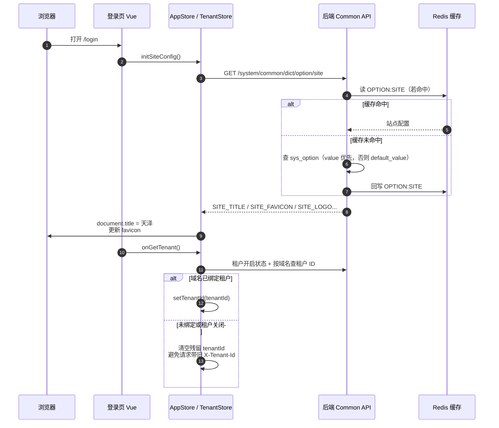
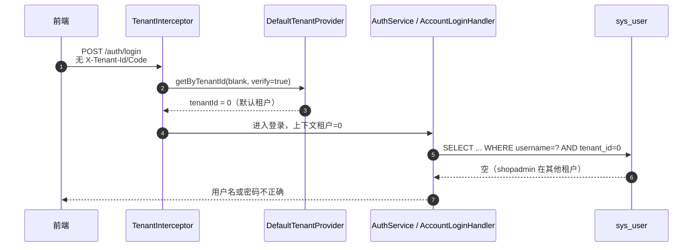
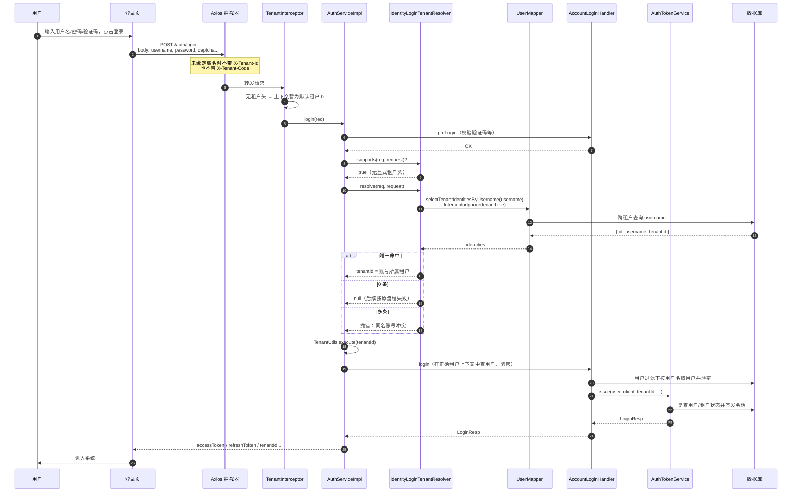
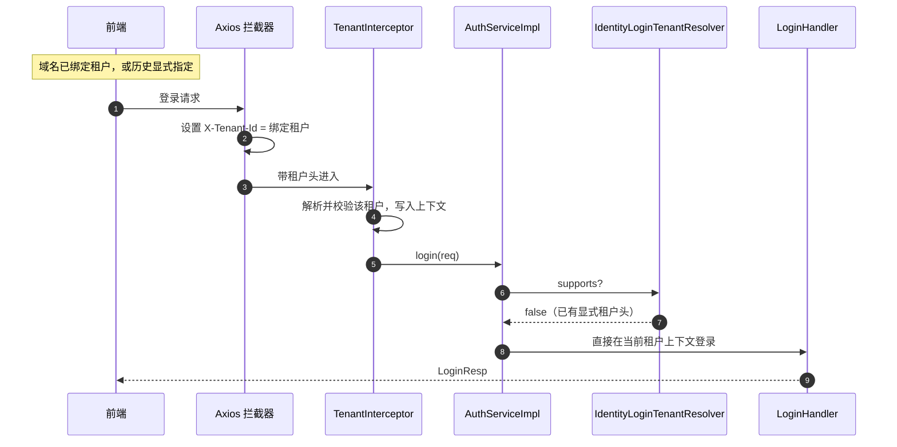

本文总结天泽（TIANZE）登录相关一轮完整优化，覆盖**前端登录体验**、**站点品牌标识**，以及去掉登录页租户编码后配套的**后端租户解析扩展**。目标读者为二次开发与联调同学。

## 优化目标

| 目标 | 说明 |
| --- | --- |
| 品牌一致 | 登录页呈现「履道坦坦 泽被万物」与天泽青绿品牌体系 |
| 布局清晰 | 保持「全屏品牌底 + 右侧悬浮登录卡」 |
| 登录简化 | 用户只需输入用户名与密码（验证码按配置保留），不再填写租户编码 |
| 多租户兼容 | 去掉编码后，非默认租户账号仍能登录；显式租户头 / 域名绑定行为不变 |
| 可扩展 | 后端按开闭原则增加 `LoginTenantResolver` 扩展点，不改 ContiNew 核心 |

## 一、前端登录页品牌化

### 1.1 整体布局

桌面端结构：

- **全屏品牌底**：青绿渐变 + 氛围光斑
- **左上**：小鹿 Logo +「天泽」
- **左侧主文案**：单行标语「履道坦坦 泽被万物」+ 系统一句话描述
- **左侧能力卡**：四张统一品牌色玻璃拟态卡片（2×2）
- **右侧**：悬浮登录卡片（账号 / 手机号 / 邮箱等登录方式）
- **底部**：版权文案

核心文件：

- `tianze-admin-ui/src/views/login/index.vue`
- `tianze-admin-ui/src/views/login/components/account/index.vue`
- `tianze-admin-ui/src/views/login/components/phone/index.vue`
- `tianze-admin-ui/src/views/login/components/email/index.vue`

### 1.2 左侧能力卡文案（落地能力，非空泛口号）

| 标题 | 说明 |
| --- | --- |
| 统一身份登录 | 账号、手机号、邮箱与第三方登录 |
| 细粒度权限 | 菜单、按钮、数据权限分级可控 |
| 操作可追溯 | 登录轨迹与操作日志完整可查 |
| 系统可配置 | 字典、参数、租户与基础模块开箱可用 |

视觉策略：四卡统一青绿强调色（非每卡分色），横向「图标 + 文案」布局，带轻微入场与悬停动效。

### 1.3 右侧登录卡打磨

- 顶部品牌色细条
- 欢迎语 + 辅助说明（「输入用户名和密码即可登录」）
- 输入框圆角、浅绿底、聚焦品牌色光晕
- 登录按钮青绿渐变与阴影
- 第三方登录圆形图标按钮

### 1.4 登录页加载时序（站点配置）

> 注意：直接改库后若标题仍是旧值，通常是 `OPTION:SITE` Redis 缓存未失效，需删除对应 key 或走系统配置保存触发清缓存。

## 二、浏览器 Title 与 Favicon

### 2.1 改动点

| 位置 | 变更 |
| --- | --- |
| `tianze-admin-ui/index.html` | 默认 `<title>天泽</title>`，favicon 指向小鹿图标并加版本参数 |
| `public/favicon.ico` / `favicon.png` | 由小鹿 Logo 重新生成 |
| `sys_option` 默认值 / 数据修补 | `SITE_TITLE=天泽`，`SITE_FAVICON=/favicon.ico?v=deer6` |
| `app.ts` | 写入 `document.title` 与 icon link 的兜底改为「天泽」 |

### 2.2 时序说明

前端最终标题以站点配置接口为准；`index.html` 仅保证首屏闪现一致。配置链路见上一节时序图。

## 三、去掉登录页租户编码

### 3.1 产品决策

用户期望：**只输入用户名和密码**，不判断自己是不是租户、不填租户编码。

因此前端：

- 移除租户编码输入框
- 移除「默认租户 / 指定租户」切换
- 登录请求不再附带 `X-Tenant-Code`
- 仅在域名已绑定租户时，请求拦截器仍可带 `X-Tenant-Id`

### 3.2 去掉编码后为何会失败

行级多租户下，`sys_user` 带 `tenant_id`。例如：

- `admin` → `tenant_id = 0`（默认租户）
- `shopadmin` → `tenant_id = 非 0`（业务租户）

旧逻辑：请求无租户头时，`DefaultTenantProvider` 回落默认租户 `0`，随后按租户过滤查用户。  
结果：`shopadmin` 在租户 `0` 下查不到 → 登录失败（用户名或密码不正确）。

## 四、后端：开闭原则下的身份租户解析

### 4.1 设计原则

- **对扩展开放**：新增 `LoginTenantResolver` 实现即可增加解析策略
- **对修改关闭**：不改 ContiNew Starter；显式租户头 / 域名绑定路径保持原行为
- **最小钩子**：仅在 `AuthServiceImpl.login` 增加「解析 → 切租户上下文 → 登录」钩子

### 4.2 关键类型与文件

| 类型 / 类 | 职责 |
| --- | --- |
| `LoginTenantResolver` | 扩展点：`supports` + `resolve` |
| `IdentityLoginTenantResolver` | 无显式租户头时，按用户名/手机号/邮箱跨租户定位唯一账号所属租户 |
| `UserTenantIdentityDO` | 跨租户查询投影（含 `tenantId`） |
| `UserMapper#selectTenantIdentitiesBy*` | `@InterceptorIgnore(tenantLine="true")` 忽略行级过滤 |
| `AuthServiceImpl` | 调用扩展点；解析成功则 `TenantUtils.execute(tenantId, login)` |

### 4.3 解析规则（IdentityLoginTenantResolver）

1. 租户功能关闭 → 不支持  
2. 请求带 `X-Tenant-Id` 或 `X-Tenant-Code` → **不介入**（显式优先）  
3. 否则按认证类型跨租户查身份：  
   - 0 条：返回 `null`，交给原登录流程报错（错误信息不泄露租户细节）  
   - 1 条：返回该账号 `tenantId`  
   - 多条：拒绝并提示「存在多个同名账号，请联系管理员通过专属域名登录」

### 4.4 完整登录时序（推荐主路径：仅用户名密码）

### 4.5 显式租户头 / 域名绑定路径（行为不变）

### 4.6 与 DefaultTenantProvider 的关系

| 组件 | 何时生效 | 作用 |
| --- | --- | --- |
| `DefaultTenantProvider` | 每个请求入口 | 把头翻译成租户上下文；无头回落默认租户 `0` |
| `IdentityLoginTenantResolver` | 仅登录且无显式租户头 | 用账号身份把上下文切到真实所属租户后再验密 |

二者互补：Provider 负责通用请求上下文；Resolver 只补「登录页不再收集租户编码」这一产品缺口。

## 五、关键代码索引

### 前端

- `tianze-admin-ui/src/views/login/index.vue` — 品牌布局、站点提示、租户 ID 清理
- `tianze-admin-ui/src/views/login/components/account|phone|email/index.vue` — 无租户编码表单
- `tianze-admin-ui/src/stores/modules/app.ts` — title / favicon 应用
- `tianze-admin-ui/src/utils/http.ts` — `X-Tenant-Id` 注入规则
- `tianze-admin-ui/index.html`、`public/favicon.ico`

### 后端

- `.../auth/tenant/LoginTenantResolver.java`
- `.../auth/tenant/IdentityLoginTenantResolver.java`
- `.../auth/service/impl/AuthServiceImpl.java`
- `.../system/mapper/user/UserMapper.java`（跨租户身份查询）
- `.../system/model/entity/user/UserTenantIdentityDO.java`
- 测试：`.../auth/tenant/IdentityLoginTenantResolverTest.java`

### 数据 / 配置

- `db/changelog/mysql/main_data.sql`、`main_data_brand.sql` — 站点标题与 favicon 默认值
- `continew-starter.tenant.*` — 租户开关与默认租户 ID

## 六、联调与验收清单

1. 重启后端，确保新 Resolver 已加载  
2. 强刷前端；确认浏览器标题为「天泽」、favicon 为小鹿  
3. 使用默认租户账号（如 `admin`）仅用户名密码登录 → 成功  
4. 使用业务租户账号（如 `shopadmin`）仅用户名密码登录 → 成功，且会话 `tenantId` 为业务租户  
5. 域名绑定租户场景：请求仍带 `X-Tenant-Id`，Resolver 不介入，行为与改前一致  
6. 若标题仍旧：检查并删除 Redis key `OPTION:SITE` 后刷新  

## 七、后续可扩展方向

在不改 `AuthServiceImpl` 主流程的前提下，可继续新增 `LoginTenantResolver` 实现，例如：

- 按客户端 ID / 渠道解析租户  
- 按自定义请求头或 Cookie 解析  
- 同名多租户时的密码消歧策略（需额外安全评估）

推荐顺序保持：`@Order` 越小越优先；显式租户头场景下各实现应自觉 `supports=false`。
